# Skyward

[English](README.md) | 简体中文

Skyward 是使用 Rust 编写的 recovery，从零开始编写。

<p align="center">
  
  
  
</p>

## 功能

### 解密

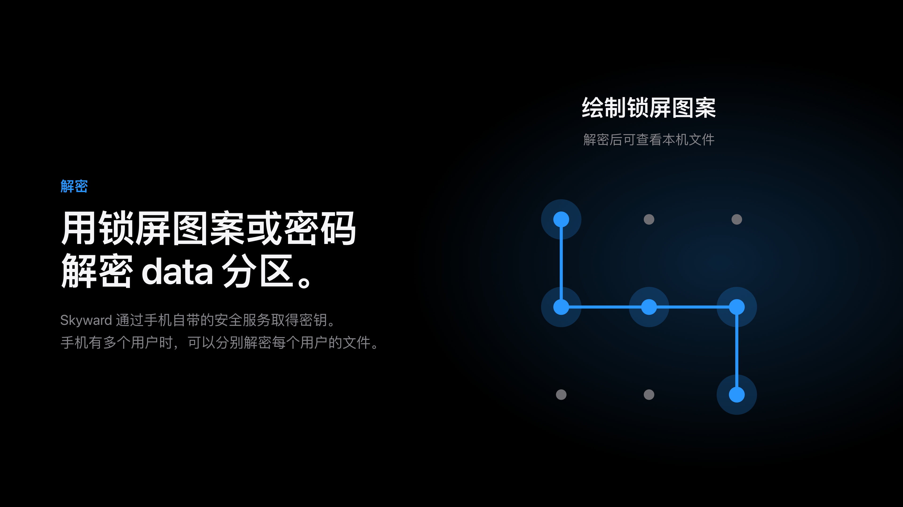

### 安装

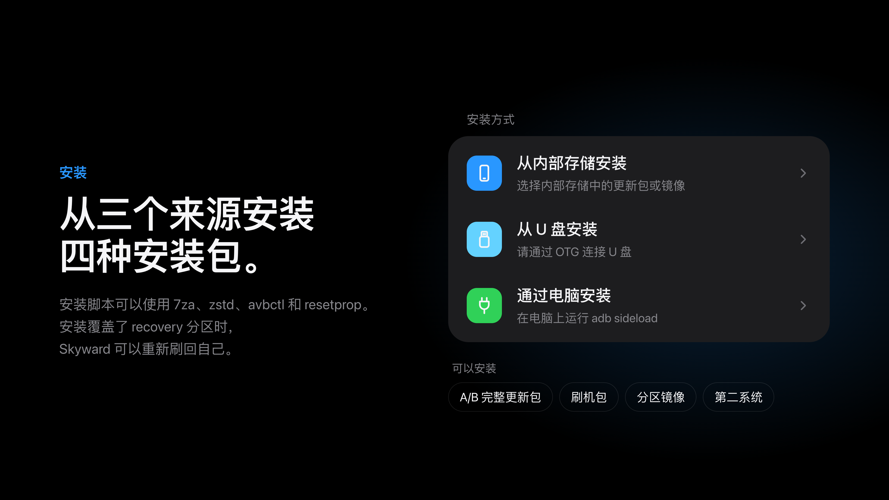

刷机包的安装脚本可以使用 `7za` 和 `zstd`，支持刷入 super 镜像使用 zstd 压缩的第三方 ROM；`unzip -p` 边解压边输出镜像。安装脚本还可以使用 `avbctl` 关闭验证启动的校验，使用 `resetprop` 读取和设置属性。

### 在线更新

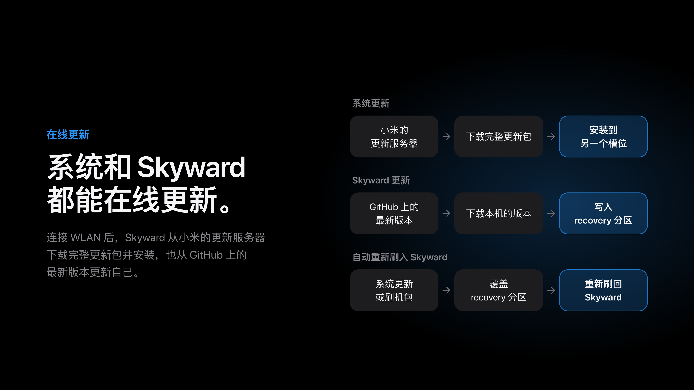

### 备份和恢复

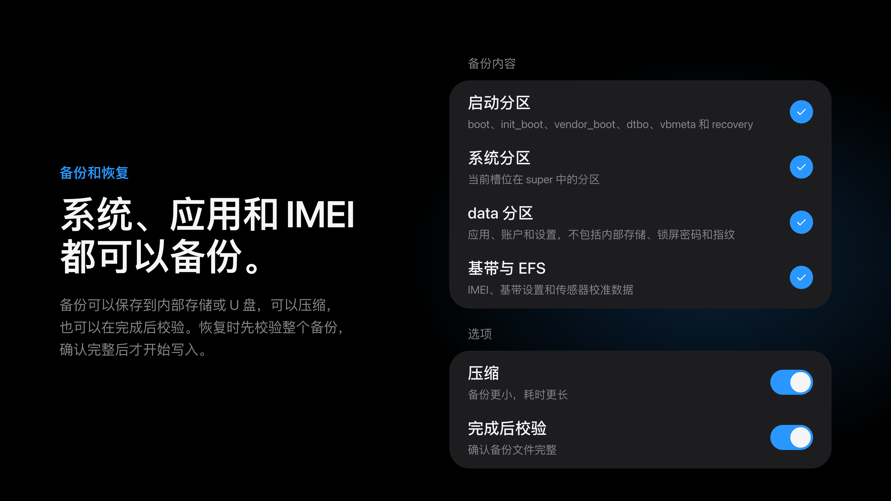

### 文件管理

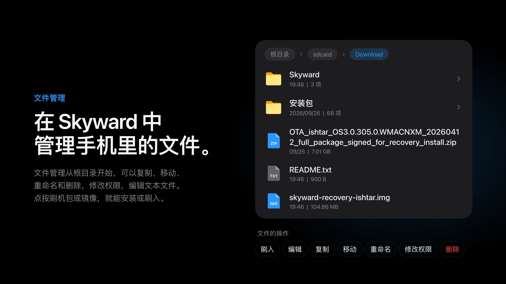

### 终端

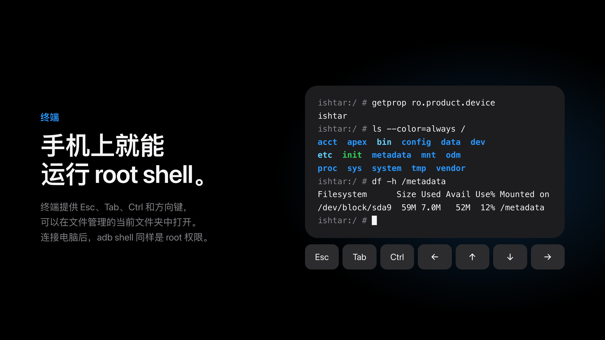

### 连接电脑

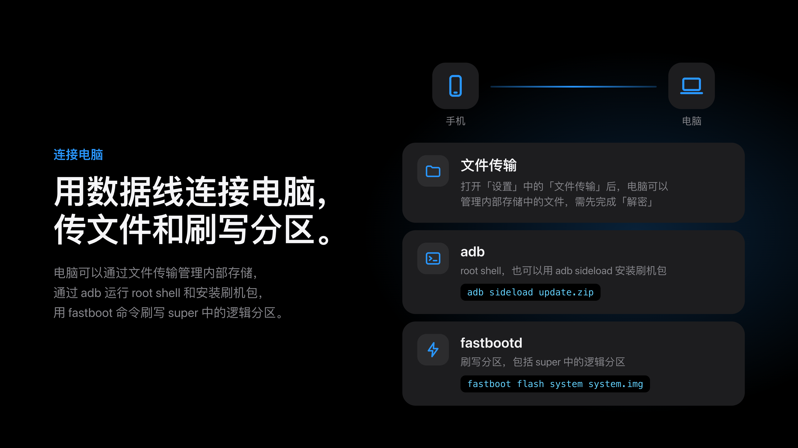

### 清除数据

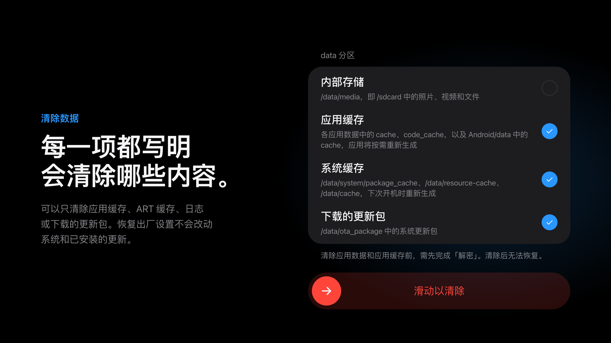

### 替换原厂 recovery

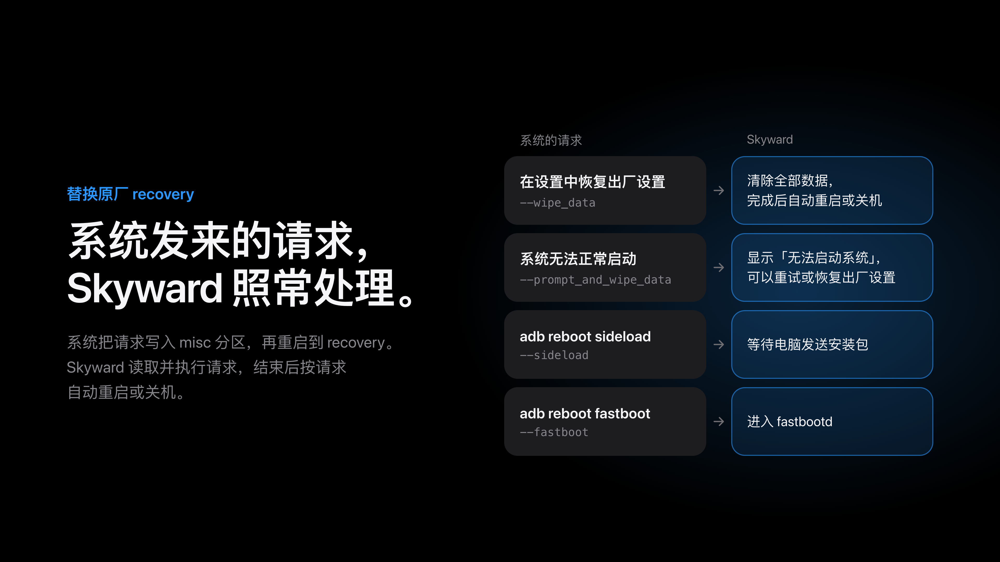

### 搜索

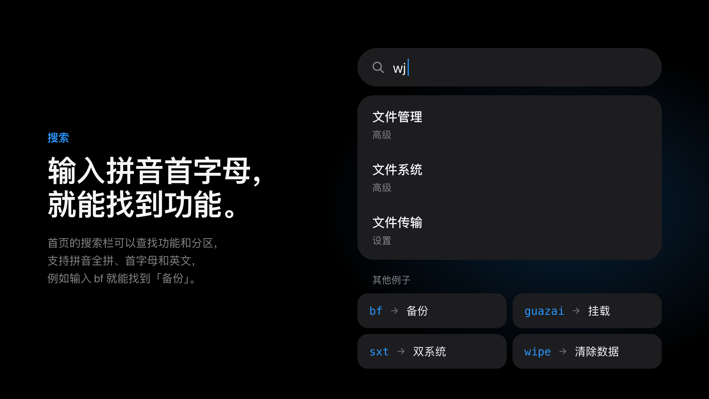

### 高级

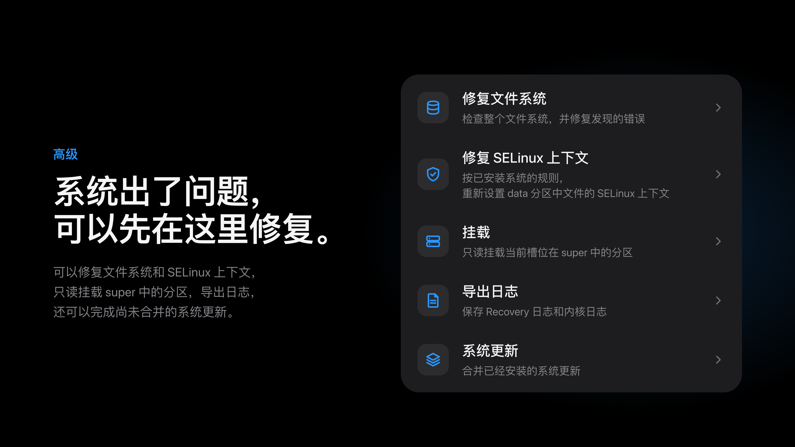

### 关于本机

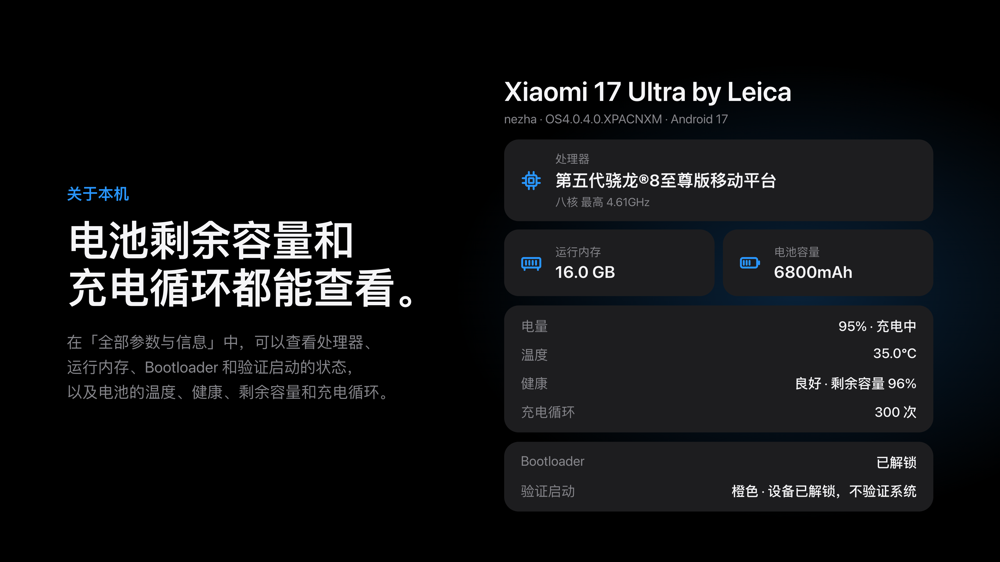

### 其他功能

- 重启到系统、recovery、fastboot、bootloader 和 EDL，切换启动槽位
- 浅色和深色模式，简体中文、繁体中文和英文

### 没有系统时

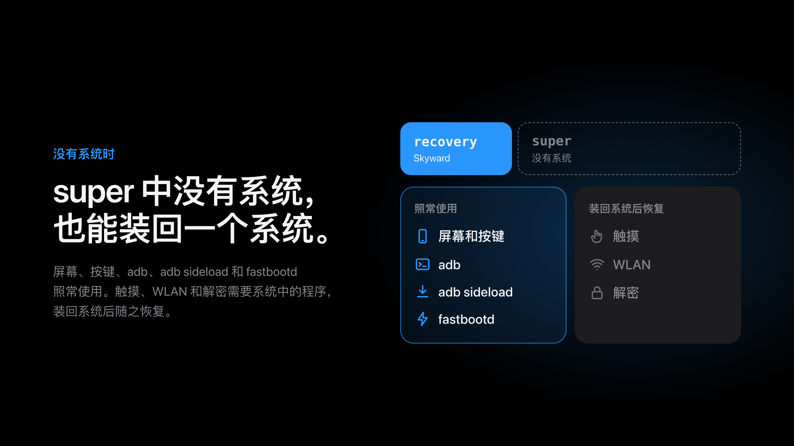

## 支持的机型

| 机型 | 代号 | 测试的系统版本 |
| --- | --- | --- |
| 小米 17 Ultra | `nezha` | OS4.0.4.0.XPACNXM（Android 17） |
| 小米 13 Ultra | `ishtar` | OS3.0.308.0.WMACNXM（Android 16） |

### 🚧 施工中

这些机型的镜像按照各自的原厂固件构建，还没有在真机上试过。屏幕、触摸、WLAN 和振动已经配置好。解密 data 分区所需的程序由 Skyward 在手机上从已安装系统的 init 脚本和服务描述中读出，每个机型的读取结果都用原厂固件核对过，这些程序在这些机型上的运行情况还没有验证。

| 机型 | 代号 | 构建所用的系统版本 |
| --- | --- | --- |
| 🚧 小米 13 | `fuxi` | OS3.0.309.0.WMCCNXM（Android 16） |
| 🚧 小米 13 Pro | `nuwa` | OS3.0.312.0.WMBCNXM（Android 16） |
| 🚧 小米 14 | `houji` | OS3.0.307.0.WNCCNXM（Android 16） |
| 🚧 小米 14 Pro | `shennong` | OS3.0.309.0.WNBCNXM（Android 16） |
| 🚧 小米 14 Ultra | `aurora` | OS3.0.308.0.WNACNXM（Android 16） |
| 🚧 小米 15 | `dada` | OS3.0.307.0.WOCCNXM（Android 16） |
| 🚧 小米 15 Pro | `haotian` | OS3.0.309.0.WOBCNXM（Android 16） |
| 🚧 小米 15 Ultra | `xuanyuan` | OS3.0.314.0.WOACNXM（Android 16） |
| 🚧 小米 17 | `pudding` | OS4.0.4.0.XPCCNXM（Android 17） |
| 🚧 小米 17 Pro | `pandora` | OS4.0.4.0.XBLCNXM（Android 17） |
| 🚧 小米 17 Pro Max | `popsicle` | OS4.0.4.0.XPBCNXM（Android 17） |
| 🚧 小米 17 Max | `byron` | OS3.0.310.0.WAFCNXM（Android 16） |
| 🚧 REDMI K80 | `zorn` | OS3.0.309.0.WOKCNXM（Android 16） |
| 🚧 REDMI K80 Pro | `miro` | OS3.0.305.0.WOMCNXM（Android 16） |
| 🚧 REDMI K90 | `annibale` | OS3.0.307.0.WPKCNXM（Android 16） |
| 🚧 REDMI K90 Pro Max | `myron` | OS4.0.4.0.XPMCNXM（Android 17） |
| 🚧 REDMI K90 Ultra | `warsaw` | OS3.0.309.0.WHPCNXM（Android 16） |
| 🚧 REDMI K100 Pro | `athens` | OS4.0.4.0.XPICNXM（Android 17） |
| 🚧 REDMI K100 Pro Max | `songyuan` | OS4.0.4.0.XGNCNXM（Android 17） |

## 安装 Skyward

Skyward 需要已解锁的 bootloader。从 [Releases](https://github.com/kirklin/skyward/releases) 下载对应机型的 zip，每个文件都标有机型和代号，例如 Xiaomi 17 Ultra (nezha)。使用 `SHA256SUMS` 核对并解压之后，在手机处于 fastboot 模式的时候，把其中的镜像刷入当前运行槽位的 recovery 分区：

```sh
unzip skyward-v0.3.1-nezha-OS4.0.4.0.XPACNXM.zip
fastboot flash recovery skyward-v0.3.1-nezha-OS4.0.4.0.XPACNXM.img
fastboot reboot recovery
```

解压出来的新版镜像也可以在 Skyward 自己的“安装”页面安装。打开 **自动重新刷入 Skyward** 之后，系统更新或者刷机包覆盖 recovery 分区的时候，Skyward 会重新刷回这些分区。

Skyward 中的 adb 是 root shell，手机上无需授权：手机处于 recovery 的时候，任何人拿到手机和数据线都能访问其中的存储。

## 构建

Skyward 使用 `rust-toolchain.toml` 指定版本的 Rust 和它的 `aarch64-linux-android` 目标、Android NDK r29 和 [cargo-ndk](https://github.com/bbqsrc/cargo-ndk) 构建。recovery 服务针对手机构建，打包工具针对电脑构建：

```sh
cargo ndk -t arm64-v8a --platform 30 build --release -p skyward
cargo build --release -p skyward-pack
```

第二系统启动时运行的第一个程序在任何动态库可用之前运行，因此构建为静态程序：

```sh
RUSTFLAGS="-C target-feature=+crt-static" cargo ndk -t arm64-v8a --platform 30 build --release -p skyward-system-init --target-dir target/system-init
```

打包工具从小米服务器上这个版本的完整更新包中取出原厂 recovery 分区，只读取这个分区所在的部分，并且按照设备配置文件核对 SHA-256：

```sh
target/release/skyward-pack stock --config devices/nezha.toml --out target/stock/nezha/recovery.img
```

然后在它的基础上构建镜像：

```sh
target/release/skyward-pack recovery \
  --stock target/stock/nezha/recovery.img \
  --binary target/aarch64-linux-android/release/skyward \
  --system-init target/system-init/aarch64-linux-android/release/system-init \
  --config devices/nezha.toml \
  --font resources/fonts/MiSansVF.ttf \
  --mono resources/fonts/KirkMono-Regular.ttf \
  --mono-license resources/fonts/KirkMono-OFL.txt \
  --out target/skyward-nezha.img
```

测试和代码检查在电脑上运行；只在手机上运行的代码按照手机目标检查：

```sh
cargo test --workspace
cargo clippy --workspace --all-targets -- -D warnings
cargo ndk -t arm64-v8a --platform 30 clippy --workspace --all-targets -- -D warnings
```

名称以 `on_the_phone` 开头的测试会创建文件系统、挂载分区、设置加密密钥，这些操作只有手机能够完成。把一台已经进入 Skyward、数据分区已经打开的手机通过 adb 连接到电脑，`cargo ndk` 会把每个测试程序推送到手机上运行，测试逐个执行：

```sh
cargo ndk -t arm64-v8a --platform 30 test -p skyward -p skyward-block -p skyward-files -p skyward-mtp on_the_phone -- --test-threads=1
```

`skyward-preview` 无需手机，在电脑上把页面绘制成 PNG 文件：每个页面完整绘制成长截图的样子，覆盖它可能处于的各种状态，另外还有触摸和动画过程中某些时刻的屏幕。`--lang` 按照地区代码选择语言，例如 `en` 或者 `zh-TW`：

```sh
cargo run --release -p skyward-preview -- target/preview --lang en
```

## 许可证

[GPL-3.0-or-later](LICENSE)
